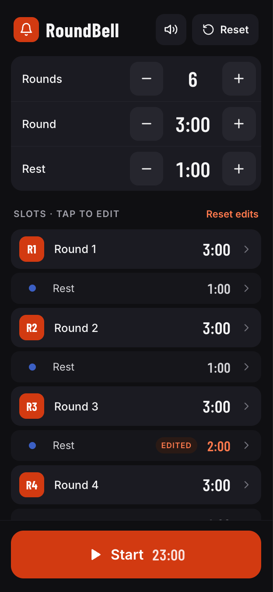
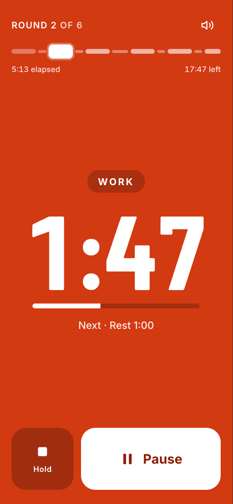
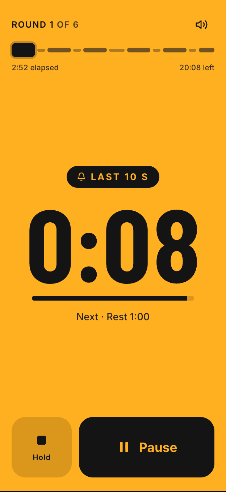
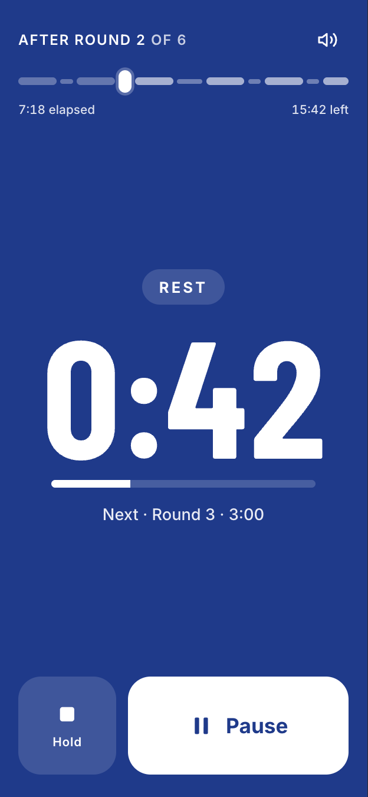

# RoundBell

**A free, ad-free round timer for boxing, kickboxing and interval training.**
Set your rounds and rests, adjust any single round, and train with the screen kept awake and the bell in your headphones.

**[Open RoundBell →](https://leva13007.github.io/round_bell/)** No sign-up, no app store. Add it to your Home Screen and it works offline.

<p align="center">
  
  
  
  
</p>

## Why

Most round timers either interrupt your training with ads or lock basic features behind a subscription. Almost all of them make every round the same length, and the phone screen goes dark mid-round, where you can't unlock it in gloves.

## Features

- **Rounds you can edit one by one.** Pick the number of rounds, round length and rest length, then tap any single round or rest to change just that one. A shorter final round or a longer rest halfway through is two taps.
- **Readable from across the room.** Huge digits and a full-screen color per stage: green for work, red for rest, amber for the last 10 seconds, and a flash on each of the last 3.
- **Loud signals in your headphones.** Bright, high-pitched sounds that cut through music: round start, rest, a 10-second warning, a 3-2-1 countdown beep and the end. Android phones vibrate too.
- **Screen stays on** for the whole workout, so the timer keeps running and the signals keep coming.
- **Made for gloves.** Large buttons, a 10-second get-ready countdown, and Stop works only when held, so a stray tap can't end your workout.
- **Whole workout at a glance.** A timeline shows every round and rest, with the current one highlighted, plus time elapsed and time left.
- **Remembers your last workout.** Reset to defaults any time, with Undo.
- **Works offline** as an installable web app. No account, no tracking, no ads.

## Install on your phone

<p align="center">
  
  <br>
  <sub>Scan with your phone's camera to open RoundBell</sub>
</p>

- **iPhone:** open the link in Safari, tap **Share → Add to Home Screen**.
- **Android:** open the link in Chrome and tap **Install** in the banner (or **⋮ → Add to Home screen**).

On iPhone, Silent mode also mutes web audio. Flip the side switch off to hear the signals. They play at your phone's media volume. A web app can't lower other apps' music, so if you train with music, keep the music a bit below full volume.

## Updating

RoundBell updates itself. There's nothing to download from a store.

1. Open the app. It checks for a new version and downloads it in the background. Your current session keeps running, so an update never interrupts a workout.
2. Close the app completely (swipe it away in the app switcher) and open it again. You're now on the new version. The version number is shown at the bottom of the Setup screen.

If you still see the old version, repeat step 2 once more. In the browser, use the reload button instead.

Re-add the app only if an update says so (for example, after a change to the app icon or how it fills the screen). Delete RoundBell from your Home Screen, then add it again as described above. On iPhone this also resets your saved workout to the defaults.

## Development

```bash
npm install
npm run dev        # http://localhost:5173/round_bell/
npm test           # unit tests (Vitest)
npm run lint       # oxlint
npm run build && npm run preview   # production build, to test offline mode
```

Built with React, TypeScript and Vite, using [`vite-plugin-pwa`](https://vite-pwa-org.netlify.app/) for offline support. The timer uses the [Screen Wake Lock](https://developer.mozilla.org/en-US/docs/Web/API/Screen_Wake_Lock_API) and [Web Audio](https://developer.mozilla.org/en-US/docs/Web/API/Web_Audio_API) APIs. The timer logic is plain TypeScript with unit tests in `src/lib/`. Every push to `main` deploys to GitHub Pages.

The product brief is in [`docs/idea.md`](docs/idea.md) (in Ukrainian).

## Status

The MVP is live. Next: test a full workout on iPhone and Android, both in the browser and from the Home Screen. After that come saved presets, workout history and ready-made programs.

## License

[MIT](LICENSE)
